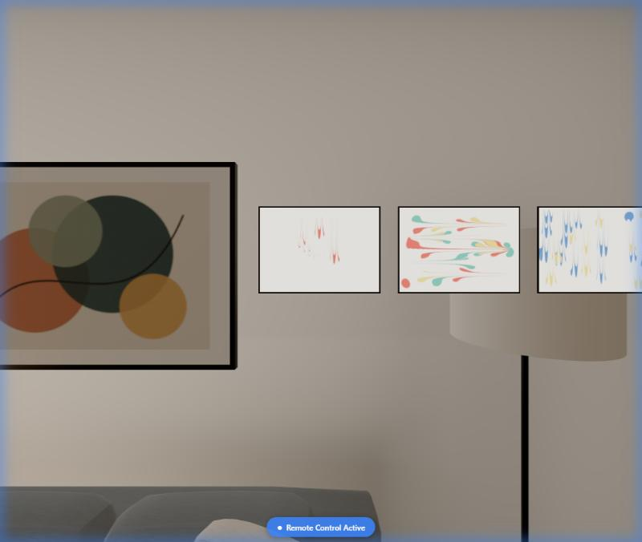
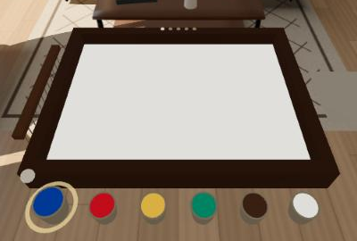
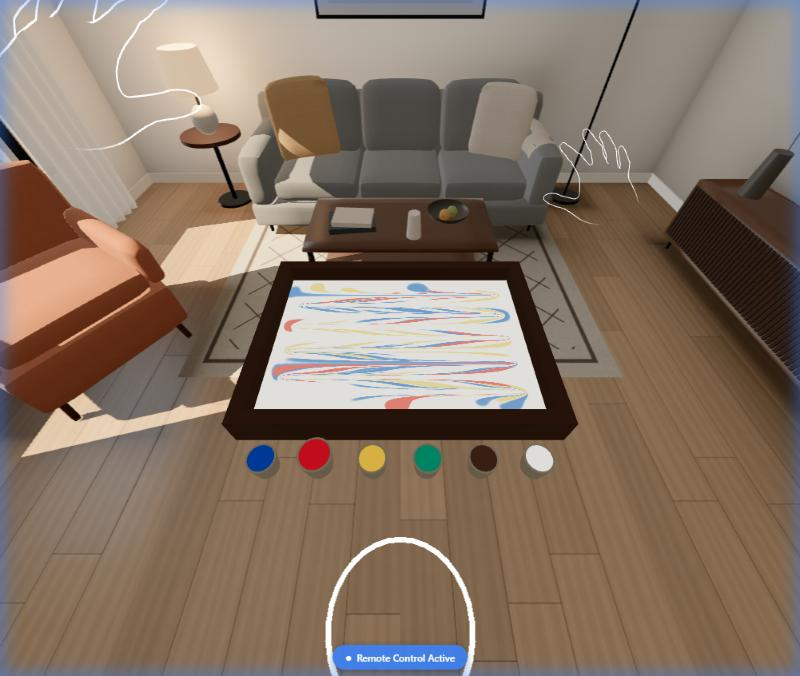
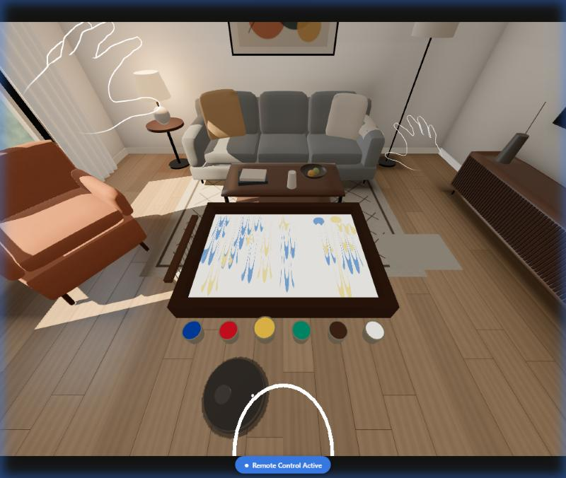
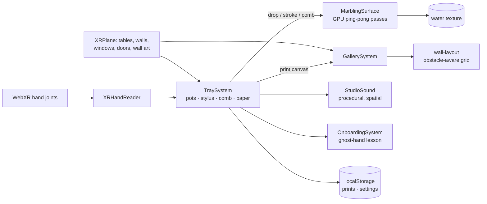

<div align="center">

# Tekne

**Turkish ebru (paper marbling) on your own desk, in mixed reality, with nothing but your hands.**

*Float paint on water. Swirl it with a fingertip. Comb it. Lift it onto paper and hang it on your real wall.*



<sub>Captured in the Immersive Web Emulator (Meta Quest 3 profile). Prints hang on a detected wall and step around the room's existing painting.</sub>

**▶ Try it on Meta Quest 3 / 3S:** [jean-regis-m.github.io/Tekne](https://jean-regis-m.github.io/Tekne/) — open in the Quest Browser, press *Enter mixed reality*, put your controllers down.
&nbsp;·&nbsp; **Demo video (2:17):** [youtu.be/LQVq5aP8SHs](https://youtu.be/LQVq5aP8SHs)

</div>

---

## Why this exists

*Ebru* is the Turkish art of marbling. Paint is sprinkled onto thickened water and shaped with an awl and a comb, and a sheet of paper laid on the surface lifts the pattern off. Each print is unique, because the water never holds the same pattern twice. The craft is on UNESCO's list of the Intangible Cultural Heritage of Humanity, yet few people ever get to try it: it needs a tray, sized water, pigments, ox gall, paper and a teacher.

Tekne (named after the marbling trough) gives you the tray, the pigments, the comb and the paper, on your actual desk. **Your hands are the brush.** On a flat screen this would be a mouse doodle. In mixed reality the water sits on your table, your fingertip dips into it, and the finished print hangs on your wall the next time you look up.

## What you do

| | Gesture | Ebru technique |
|---|---|---|
| 🎨 | **Poke** a paint pot | choose a pigment |
| 💧 | **Pinch** above the water, **release** | drop paint (*battal* ground); higher drops spread wider |
| ☝️ | **Dip your fingertip** and drag | stylus work (*gelgit*, back-and-forth) |
| 🪮 | **Pinch the comb** off the rim and pull | combed patterns (*tarama*) |
| 📄 | **Pinch the paper**, lay it on the water, let go | lift the print; the water clears for the next one |
| 🖼️ | (automatic) | the print flies to your real wall and joins your gallery |

There are no menus and no controllers. Every tool is an object on the tray rim. A **wordless five-step lesson** on first launch has a ghost fingertip act out each gesture inside the real tray, and each step completes only when you actually do it.

<table>
<tr>
<td><br><sub>First launch: ring + ghost fingertip, no text</sub></td>
<td><br><sub>Gelgit, drawn with a fingertip</sub></td>
<td><br><sub>Tarama, pulled with the comb</sub></td>
</tr>
</table>

<sub>All images in this README are captures from the Immersive Web Emulator, not from a headset.</sub>

## What makes it different

- **Hands are the content, not a cursor.** Drops, strokes and combing are continuous physical gestures. There is no point-and-click layer.
- **Exact marbling, not a blur.** Paint follows the closed-form model in S. Lu, A. Jaffer et al., *"Mathematical Marbling"* (IEEE CG&A, 2012):
  - Every drop conserves area, pushing earlier paint outward exactly as ink does on size.
  - Strokes and combs drag the fluid with a smooth falloff.
  - Each operation is one inverse-mapped GPU pass over a 1536 × 1088 texture. Idle cost is zero.
- **Your room matters** (purposeful passthrough):
  - The tray snaps onto a detected table at seated height.
  - Prints hang on the wall you face, at eye level.
  - Prints slide along the wall to avoid detected windows, doors and existing wall art.
- **A reason to come back.** Prints are kept on the device, and your wall gallery greets you next time.

## Comfort and accessibility

- **Seated, one-handed, untimed:** every action works with either hand alone, within arm's reach. Nothing can be failed.
- **Three engraved tiles** on the tray rim, poked like the pots, and remembered on the device:
  - **Hover painting:** paint by hovering about 3 cm above the water, with no precise dipping.
  - **High contrast:** maximally distinct pigments.
  - **Sound** on/off.
- **Tremor smoothing** on the stylus, plus pinch hysteresis to prevent accidental drops.
- **Wordless onboarding:** no reading required. Gestures are shown, not described.
- **Pause and resume:** audio suspends when the system menu opens, and your pattern stays on the water.

## Sound

Every sound is **synthesised at runtime** with Web Audio. There are no recorded samples, so there are no third-party audio licences. The sounds are a quiet water bed, a pitched "plip" per pigment, a swish that follows stroke speed, a wooden tock for pots and tiles, and a paper rustle with a soft bell when a print lifts. All sources are spatialised at the tray (HRTF) and follow your head.

## Technology

| Layer | Choice |
|---|---|
| Runtime | WebXR on Meta Quest Browser, `immersive-ar` (passthrough) |
| SDK | [Immersive Web SDK](https://iwsdk.dev) `@iwsdk/core` 1.1.0-rc.2 (three.js r185, ECS) |
| Scene understanding | IWSDK `SceneUnderstandingSystem` (`XRPlane` for tables, walls, windows, doors, wall art) |
| Input | WebXR articulated hand joints (25 per hand), read directly every frame |
| Simulation | GLSL ping-pong passes (drop, stroke, comb) after Lu, Jaffer et al. 2012 |
| Audio | Web Audio API, procedural, HRTF panner |
| Testing | Vitest unit tests; Immersive Web Emulator (IWER 2.7) driven by its remote-control API |
| Hosting | Static build (Vite), GitHub Pages |

### Architecture



| Module | Responsibility |
|---|---|
| `src/marbling/ops.ts` | Marbling maths (CPU reference, unit-tested) and palettes |
| `src/marbling/surface.ts` | GPU passes: drop, stroke, comb; print read-back |
| `src/marbling/tray-system.ts` | Tray placement on a table, hand input, tools, counters |
| `src/marbling/tools.ts` · `tiles.ts` | Comb, paper, print frames, persistence, comfort tiles |
| `src/gallery/` | Wall selection, obstacle-aware layout, fly-in animation |
| `src/onboarding/` | Lesson flow (pure, tested) and ghost-hand demonstrations |
| `src/audio/sound.ts` | Procedural spatial sound |
| `src/hands/` | Joint reading, hand features, a pose recognizer kept for future gestures |
| `src/debug/perf-hud.ts` | In-headset fps / frame-time / GPU-pass readout (`?hud=1`) |

## Run it

**Requirements:** Node.js 22.12+ (see `.nvmrc`), and a Meta Quest 3 or 3S with hand tracking on (or just a desktop browser for the emulator).

```bash
npm install
npm run dev          # HTTPS dev server with the Immersive Web Emulator on localhost
```

- **Desktop:** open the printed `https://localhost:8081/`. The emulator (Quest 3 profile, synthetic living room with walls and tables) is injected automatically on localhost.
- **Headset on the same network:** open the printed `Network` URL in the Quest Browser, accept the local certificate warning, and enter MR. Add `?hud=1` for the performance readout. On Windows, Node.js must be allowed through the firewall for the network profile in use.
- **Replay the lesson:** add `?lesson` to the URL.
- **Plain HTTP for local emulator testing only:** `IWSDK_HTTP=1 npx vite --port 8082`.

```bash
npm run typecheck    # TypeScript
npm test             # unit tests (Vitest)
npm run build        # static production build in dist/
```

**Deployment.** The live site is served by GitHub Pages from the `gh-pages` branch (Settings → Pages → Deploy from a branch → `gh-pages` / root). To publish a new build: run `npm run build`, add an empty `dist/.nojekyll` (Vite emits a file whose name starts with `_`, which Jekyll would otherwise drop), and commit the contents of `dist/` to `gh-pages`. Per the competition rules, the deployed build is not changed between the submission deadline and the winner announcement.

## Testing

| What | How | Status |
|---|---|---|
| Marbling maths (area conservation, inverse maps, step-wise spreading) | Vitest | ✅ |
| Lesson flow (advances only on real actions) | Vitest | ✅ |
| Wall layout (never off-wall, never over windows or wall art, 1–6 prints) | Vitest | ✅ |
| Hand-pose features and recognizer on the emulator's own hand skeletons | Vitest | ✅ |
| Drops, stylus, comb, paper, gallery, lesson, comfort tiles | Immersive Web Emulator, scripted hand input via its remote-control API | ✅ in emulator |
| Frame rate on Meta Quest 3/3S | In-headset HUD (`?hud=1`) | ⏳ see Performance below |

27 unit tests pass (`npm test`). Emulator results show the logic works; **they are not headset validation**.

## Performance

Every number below says where it was measured. Laptop and emulator numbers do **not** stand in for the headset: Quest renders two eyes at a much higher resolution on a mobile GPU.

**On Meta Quest 3 / 3S (device)**

| Scenario | Average fps | Worst frame | Measured by |
|---|---|---|---|
| Idle in mixed reality | *pending* | *pending* | — |
| Painting continuously (drops, stylus, comb) | *pending* | *pending* | — |

To reproduce on a headset: open the live link with `?hud=1`. A readout below your view shows frames per second, worst frame time and GPU passes per second over 1-second windows.

**On a laptop in the Immersive Web Emulator (not a headset)** — Intel Core i5-8350U, Intel UHD Graphics 620 integrated GPU, Quest 3 emulator profile, 1280×720, 2026-11-04:

| Measurement | Result |
|---|---|
| Frame rate, window visible, in XR | steady 60 fps (display refresh cap) |
| GPU cost: fingertip stroke pass | 0.30 ms (was 2.10 ms before region-limited passes) |
| GPU cost: comb pass, 12 tines | 0.79 ms (was 7.58 ms) |
| GPU cost: drop spread step (full texture by design) | ≈1.3 ms |
| Full scene render, 57 draw calls, 10.6k triangles | ≈2.4 ms |
| Heaviest painting frame (render + comb + 2 strokes + 1 drop step) | ≈5 ms of the 16.7 ms budget for 60 fps |

GPU costs were timed with a synchronous read-back after each operation. Region-limited passes were verified byte-for-byte identical to full-texture passes (6.7 MB compared, zero differences).

## Known limitations

- On-device frame rate and tracking quality: see *Performance* (device rows are filled in only from headset measurements).
- Prints are stored only in this browser on this headset (up to 12). There are no accounts and no cloud.
- If the room has no scanned table or wall, the tray floats at seated height and prints hang in a row behind it.
- Drops spread in six discrete GPU steps. Very long sessions slowly soften fine detail through resampling, and lifting a print starts a fresh tray.

## Roadmap

- Guided traditional motifs (*lale* tulip, *şal*, *bülbül yuvası*) with ghost guides
- *Serpme*: flick a horsehair brush to spray fine drops
- A daily motif and a seasonal palette
- Export a print as an image to share

## Prior art and credits

- *Fluid Sketching: Bringing Ebru Art into VR* (RWTH Aachen, Mensch und Computer 2018) is a particle-based VR demo of ebru. Tekne differs by running in mixed reality on your own desk and walls, controller-free, with an exact area-conserving model.
- S. Lu, A. Jaffer, X. Jin, H. Zhao, X. Mao, "Mathematical Marbling," *IEEE Computer Graphics and Applications*, 32(6), 2012.
- Built on the Immersive Web SDK, three.js and the Immersive Web Emulator by Meta (MIT). See [THIRD_PARTY_NOTICES.md](THIRD_PARTY_NOTICES.md).

Tekne is an independent project built for the Meta VR Start Developer Competition 2026. It is not affiliated with or endorsed by Meta.

## License

[MIT](LICENSE)
